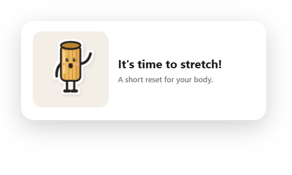

<div align="center">



# Noodle

**A friendly little stretch-break companion that lives in your Windows tray.**

Every so often, Toni the Rigatoni slides in, waves hello, and walks you through a quick stretch.


[Install](#-install-on-windows) · [Features](#-features) · [Configure](#%EF%B8%8F-configure) · [Automation](#-local-http-api) · [Claude Code hooks](#-optional-claude-code-hooks)

</div>

---

## 👋 Meet the break

<table>
<tr>
<td align="center" width="33%"><br><sub><b>1 · The nudge</b><br>Toni waves and types the intro.</sub></td>
<td align="center" width="33%"><br><sub><b>2 · The stretch</b><br>A timed card with a progress bar.</sub></td>
<td align="center" width="33%"><br><sub><b>3 · The how-to</b><br>Step-by-step instructions, one click away.</sub></td>
</tr>
</table>

Toni **waves, breathes, blinks, walks, and moves through each exercise** with smooth entry and pose transitions. If Windows is set to reduce motion, Noodle shows still poses and plain text instead, and still shows every message.

## ✨ Features

| | Feature | Details |
|:-:|---|---|
| ⏱️ | **Screen-time reminder** | Fires after 30 active minutes by default. Stepping away for 5 minutes resets the clock. |
| 🧘 | **Guided sessions** | A short run of timed stretches (neck, chin tuck, doorway, shoulders, wrists, 20-20-20 eyes). |
| 🚶 | **Walk breaks** | Every few sessions, Noodle swaps the stretches for a 2-minute walkaround. |
| 🎛️ | **Tray controls** | Show now · Open cast · Pause 1 hour · Start with Windows · Quit |
| 📊 | **Daily count** | Session tally kept in `%APPDATA%\noodle\log.json`. |
| 🔌 | **Local HTTP API** | Trigger or cancel breaks from scripts, hooks, or other tools. |
| ♿ | **Accessible motion** | Follows the system `prefers-reduced-motion` setting. |
| 🔒 | **Private by design** | No accounts and no telemetry. It only listens on `127.0.0.1`. |

## 🍝 The Noodle Cast

Both mascots are drawn live as SVG by the app's own renderer. Open the cast from the tray to browse every pose, face, and palette swatch.

<table>
<tr>
<td align="center" width="50%"><br><sub><b>Toni</b> · the Rigatoni</sub></td>
<td align="center" width="50%"><br><sub><b>Sammy</b> · the Spaghetti</sub></td>
</tr>
</table>

## 🚀 Install on Windows

> **Requires** [Node.js LTS](https://nodejs.org/).

1. **[Download Noodle as a ZIP](https://github.com/Nanoxlr8/noodle/archive/refs/heads/main.zip)** and extract it somewhere local.
2. Open PowerShell in the extracted folder and run:

   ```powershell
   npm install
   Copy-Item config.example.json config.json
   npm start
   ```

3. Look for Toni in your system tray. 🎉

> [!TIP]
> After the first install, double-click **`start-noodle.cmd`** to start Noodle silently in the background.

## ⚙️ Configure

### `config.json`

| Key | Default | What it does |
|---|:-:|---|
| `screen_time` | `true` | Turn the active screen-time reminder on or off. |
| `screen_time_min` | `30` | Active minutes before a break pops up. |
| `idle_reset_min` | `5` | Idle minutes that count as a natural break and reset the clock. |
| `cooldown_min` | `25` | Minimum gap between hook-triggered breaks. |
| `start_delay_sec` | `20` | Delay between a `/start` call and the card appearing. |
| `walk_every_sessions` | `4` | Turn every Nth session into a walk break. |
| `walk_after_min` | `10` | Minutes since the last walk after which a session becomes a walk break. |
| `port` | `47321` | Local port for the HTTP API. |

### `exercises.json`

Each entry sets the `title`, `instruction`, `duration_sec`, `duration_label`, mascot `pose`, and `how_to` steps. Noodle re-reads the file at the start of each session, so your edits apply without a restart.

<details>
<summary><b>Example exercise</b></summary>

```json
{
  "id": "chin_tuck",
  "title": "Chin tuck",
  "instruction": "Pull your chin straight back to make a double chin.",
  "duration_sec": 30,
  "duration_label": "10 sec × 3",
  "pose": "chin_tuck",
  "how_to": ["Sit tall and look straight ahead.", "Slide your chin straight back.", "Hold for 10 seconds.", "Repeat 3 times."]
}
```

Available poses: `idle` · `wave` · `doorway` · `chin_tuck` · `neck_side` · `peek` · `walk`

</details>

## 🔌 Local HTTP API

All endpoints listen on `http://127.0.0.1:47321`.

| Method | Path | Effect |
|:-:|---|---|
| `POST` | `/show` | Show a break card now. |
| `POST` | `/start` | Show a card after `start_delay_sec`, unless the cooldown is still running. |
| `POST` | `/stop` | Cancel a pending `/start`. |
| `GET` | `/status` | Returns `{ open, pending, kind, screenTime, activeMin }`. |

```powershell
Invoke-RestMethod -Method Post http://127.0.0.1:47321/show
```

## 🤖 Optional Claude Code hooks

Noodle works fine on its own. If you use Claude Code, it can offer a stretch while Claude is working:

1. Open `hooks/settings-snippet.json` and replace `<path-to-noodle>` with the path to your local folder.
2. Merge its `hooks` block into `~/.claude/settings.json`.

Sending a prompt calls `/start`, which begins the delay. When Claude finishes, `/stop` cancels it. The cooldown still applies. The hook never prints output, and it always exits within 0.5 s, even when Noodle isn't running.

## 🛠️ Development

| Command | Purpose |
|---|---|
| `npm start` | Run the app. |
| `npm test` | Check the live animation layers and the reduced-motion fallback. |
| `npm run screenshots` | Write fresh PNGs to `screenshots/`. |

<div align="center">
<br>
<sub>Made with 🍝 and good posture.</sub>
</div>
