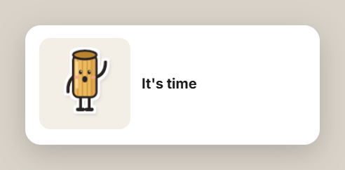
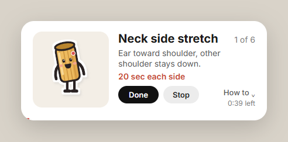
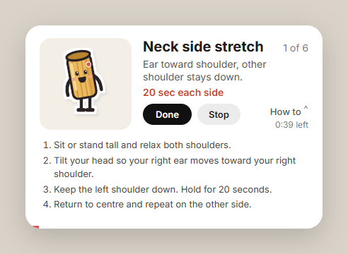
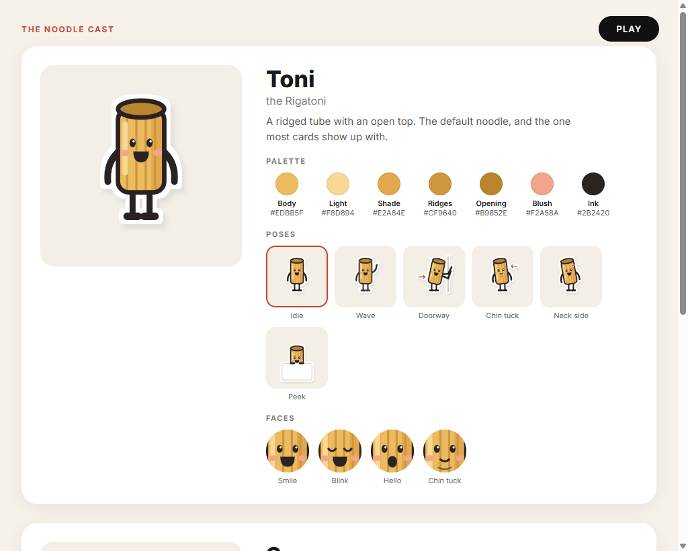
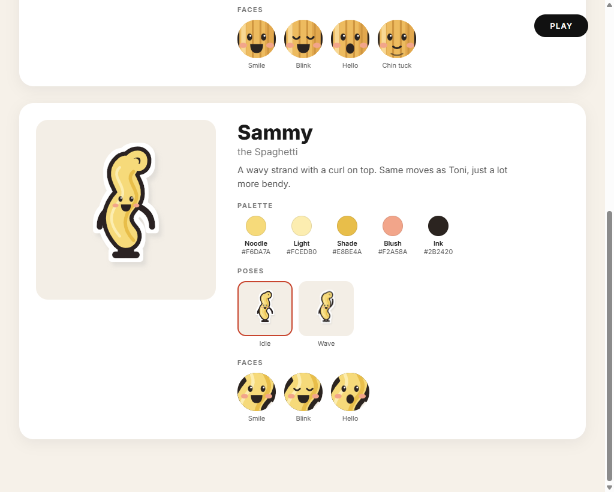

# Noodle

A small Windows tray app that brings up a friendly, timed stretch-break card. It runs locally with Electron and does not require an editor integration.

<p align="center">
  
  
  
</p>

The reminder begins with an “It’s time” prompt, then opens the timed card and its optional how-to steps.

## What it does

- Shows a short sequence of configurable exercise reminders with a timer and expandable instructions.
- Uses an active screen-time reminder by default: every 30 minutes, with a 5-minute idle reset.
- Includes tray controls for **Show now**, **Open cast**, **Pause 1 hour**, **Start with Windows**, and **Quit**.
- Keeps a daily session count at `%APPDATA%\noodle\log.json`.
- Offers local HTTP controls for automation: `POST /show`, `POST /start`, `POST /stop`, and `GET /status` on `127.0.0.1:47321`.

## Screenshots

Toni and Sammy, the two locally rendered mascot characters, are built from the app's own SVG renderer.

<p align="center">
  
  
</p>

## Install on Windows

1. Download and install the current Node.js LTS release from [nodejs.org](https://nodejs.org/).
2. [Download Noodle as a ZIP](https://github.com/Nanoxlr8/noodle/archive/refs/heads/main.zip) and extract it somewhere local.
3. Open PowerShell in the extracted folder and run:

   ```powershell
   npm install
   Copy-Item config.example.json config.json
   npm start
   ```

   You can also double-click `start-noodle.cmd` for a silent background start after the first install.

## Configure it

- `exercises.json` defines the title, instruction, duration, mascot pose, and expandable steps. The app reads it at each session.
- `config.json` controls the cooldown, start delay, local port, walk cadence, screen-time reminder, and idle reset. The supplied defaults set `screen_time_min` to `30` and `idle_reset_min` to `5`.
- `npm run screenshots` writes fresh PNGs to `screenshots/`.

## Optional Claude Code hooks

Noodle works on its own. If you use Claude Code, you can optionally replace `<path-to-noodle>` in `hooks/settings-snippet.json` with your local folder, then merge its `hooks` block into `~/.claude/settings.json`.

The `/start` hook begins the configured delay and `/stop` cancels it. A reminder still respects the configured cooldown.
